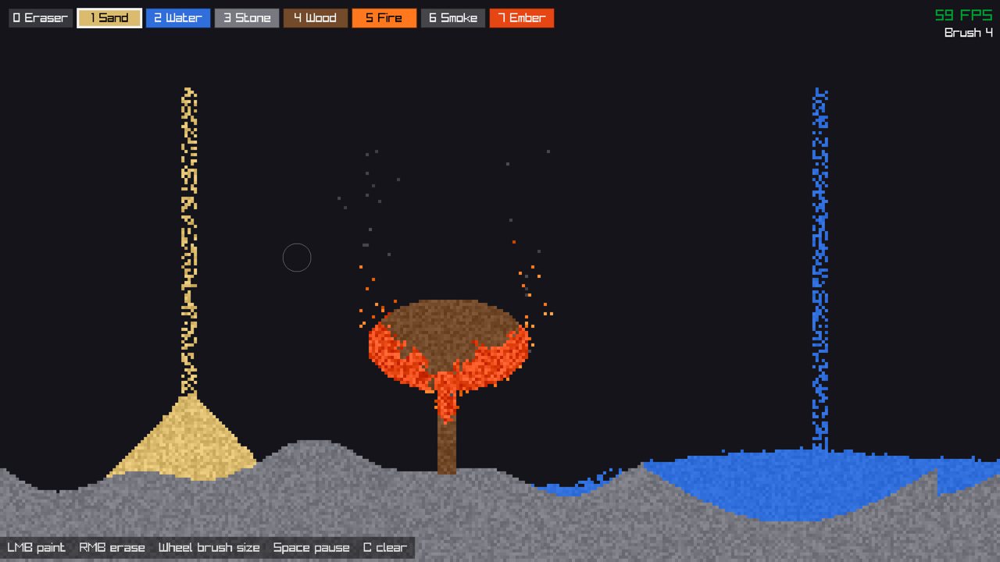

# Grainfall

[](https://github.com/shivamsingh262/grainfall/actions/workflows/ci.yml)

A small falling-sand sandbox written in C++20 with [raylib](https://www.raylib.com/).
Pour sand, flood it with water, build stone walls, and set wooden forests on fire.



- 320×180 cellular-automaton grid, drawn with a single texture upload per frame
- Sand, water, stone, wood, fire, smoke and embers, with density, burning and lifetimes
- Elements are rows in a data table, so adding one usually needs no new simulation code
- Builds on Linux, macOS and Windows; raylib is fetched automatically, no other dependencies

## Building

You need **CMake 3.20+** and a **C++20 compiler** (GCC 10+, Clang 12+, Apple Clang 13+ or Visual Studio 2022).
raylib is downloaded during configuration, so the first configure needs an internet connection.

```sh
git clone https://github.com/shivamsingh262/grainfall.git
cd grainfall
cmake -B build
cmake --build build
```

Then run it:

| Platform | Command |
|---|---|
| Linux / macOS | `./build/grainfall` |
| Windows (Visual Studio generator) | `build\Release\grainfall.exe` or `build\Debug\grainfall.exe` |

The build defaults to `Release` with single-config generators (Makefiles, Ninja). With Visual Studio,
pass `--config Release` to `cmake --build` for a fast build.

### Platform notes

- **Linux**: raylib needs the X11 and OpenGL development headers.
  - Debian/Ubuntu: `sudo apt install build-essential cmake libx11-dev libxrandr-dev libxinerama-dev libxcursor-dev libxi-dev libgl1-mesa-dev`
  - Fedora: `sudo dnf install gcc-c++ cmake libX11-devel libXrandr-devel libXinerama-devel libXcursor-devel libXi-devel mesa-libGL-devel`
- **macOS**: install the Xcode Command Line Tools (`xcode-select --install`) and CMake (`brew install cmake`).
- **Windows**: install Visual Studio 2022 with the "Desktop development with C++" workload, which includes CMake.

## Controls

| Input | Action |
|---|---|
| Left mouse | Paint the selected element |
| Right mouse | Erase |
| `1`–`9` or click the palette | Select an element |
| `0` | Eraser |
| Mouse wheel | Brush size |
| `Space` | Pause / resume (painting still works while paused) |
| `C` | Clear the grid |
| `Esc` | Quit |

Tip: paint a block of wood, then paint fire just underneath it.

## How it works

The world is a fixed grid of cells. Each cell stores an element type plus a few bytes of per-particle
data: a color shade, a remaining lifetime, and frame stamps that stop a particle from being updated
twice in one frame.

Every frame the grid is scanned **bottom-up**, with the horizontal direction picked at random so piles
don't lean to one side. Each particle follows the rule for its movement class:

| Movement | Rule |
|---|---|
| `None` | Stays put (stone, wood, embers) |
| `Powder` | Falls; if blocked, slides diagonally, which forms sloped piles |
| `Liquid` | Like powder, then flows sideways up to `dispersion` cells to level out |
| `Gas` | Rises with a random wobble and spreads along ceilings |

On top of movement, a few shared properties add the interesting behavior:

- **Density**: a falling particle can swap with a lighter liquid or gas, so sand sinks through water.
- **Lifetime**: particles with `lifetimeMax > 0` turn into `decaysInto` when their life runs out (fire → smoke → empty).
- **Burning**: cells that `ignites` can set neighbors with `flammability` alight, turning them into their
  `burnsInto` element. A neighbor that `extinguishes` puts them out.
- **Emission**: cells with `emitChance` occasionally spawn `emits` above themselves (embers throw flames).

Wood, for example, burns into **Ember**, which stays in place, spreads fire, throws flames, and finally
turns to smoke.

## How to add an element

Most elements need only two edits. Here's **Oil**: a liquid that floats on water and burns readily.

**1. Add an id** in [`src/elements.h`](src/elements.h), before `Count`:

```cpp
enum class ElementId : uint8_t {
    // ...
    Ember,
    Oil,
    Count
};
```

**2. Add a row** at the same position in the table in [`src/elements.cpp`](src/elements.cpp). Fields
you leave out keep their defaults from `ElementDef`:

```cpp
    {.name = "Oil",
     .color = {60, 45, 30, 255},
     .colorJitter = 8,
     .movement = Movement::Liquid,
     .density = 80,                    // lighter than water (100), so it floats
     .dispersion = 3,
     .flammability = 60,
     .burnsInto = ElementId::Ember},   // burn in place like wood instead of floating away as fire
```

That's it. Rebuild and Oil appears in the palette, with a number key if it's among the first nine.
The order in the enum is the palette order, and a `static_assert` catches a missing table row.

If your element needs behavior that the existing properties can't express:

- **A new kind of movement**: add a `Movement` value and an `updateXxx` function in [`src/grid.cpp`](src/grid.cpp),
  and call it from the `switch` in `Grid::step()`.
- **A new interaction** (like acid dissolving things): add a property to `ElementDef` and a small
  `updateXxx` step in `Grid::step()`, modeled on `updateBurning`. Keep it data-driven, so other
  elements can opt in by setting the property.

## Project layout

| File | Purpose |
|---|---|
| `src/main.cpp` | Window, main loop, mouse painting |
| `src/elements.h/.cpp` | `ElementId`, `ElementDef` and the element table |
| `src/grid.h/.cpp` | Cell storage and the simulation rules |
| `src/renderer.h/.cpp` | Grid → pixel buffer → one texture → one draw call |
| `src/ui.h/.cpp` | Palette, brush size, pause/clear, HUD |

## Contributing

Contributions are welcome. New elements are a great first PR! See [CONTRIBUTING.md](CONTRIBUTING.md).

## License

[MIT](LICENSE) © 2026 Shivam Singh
